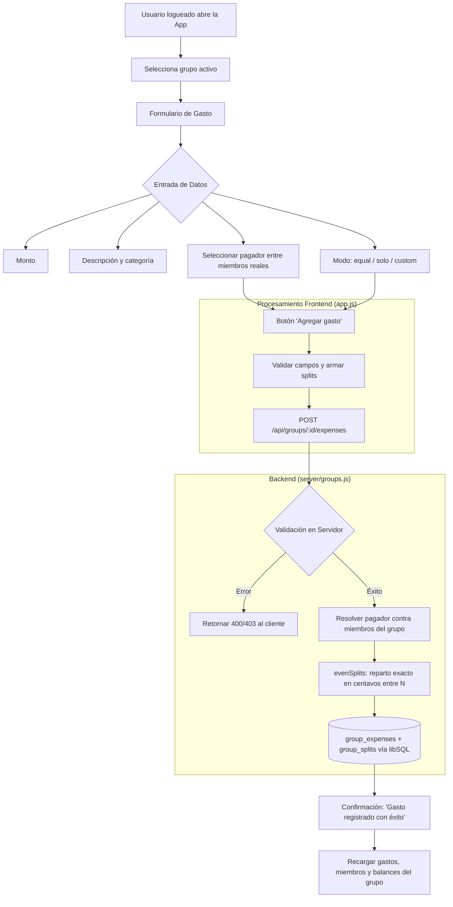
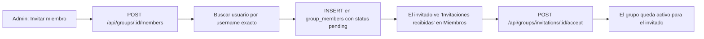

# Diagrama de Flujo del Registro de Gastos

> Actualizado al 2026-11-21. El flujo anterior usaba el endpoint legacy `/api/expense`, eliminado.

## Diagrama de Flujo (Mermaid)

## Descripción del Flujo Detallado

1. **Interfaz de usuario**: el usuario elige el grupo activo (cada cuenta crea automáticamente su propio grupo `Mis gastos` y puede pertenecer a otros compartidos). El grupo elegido se guarda en `localStorage` y se restaura al recargar.
2. **Captura de datos**: monto, descripción, categoría, fecha, pagador y modo de reparto. El selector de pagador se genera desde `currentGroupMembers` (`app.js:430-449`), no desde una lista fija de personas.
3. **Comunicación**: se envía `POST /api/groups/:id/expenses` (`server/groups.js:389`), con el group ID en la URL. El grupo **no** se toma de un parámetro del body.
4. **Validación en servidor**: monto > 0, fecha calendario válida `YYYY-MM-DD`, pagador miembro del grupo, modo válido y suma de splits `custom` tolerada en 1 centavo (`server/groups.js`).
5. **Reparto**: con `equal`, `evenSplits()` divide el total entre todos los miembros y distribuye el resto en centavos para que la suma sea exacta (`server/groups.js:53-62`). Con `solo`, la parte completa va al pagador. Con `custom`, se respetan los montos enviados.
6. **Persistencia**: se insertan la fila en `group_expenses` y una fila por participante en `group_splits` usando libSQL (`@libsql/client`).
7. **Confirmación**: se muestra el mensaje de éxito y se recargan la lista de gastos, los miembros y los balances del grupo.

## Flujo de invitación (relacionado)

Para que otro usuario aparezca como pagador posible, un admin del grupo debe invitarlo desde la pestaña Miembros con su username exacto:

La invitación **requiere aceptación** del invitado desde la pestaña Miembros y no envía notificación. Mientras está pendiente, el usuario no puede ver los datos del grupo.
